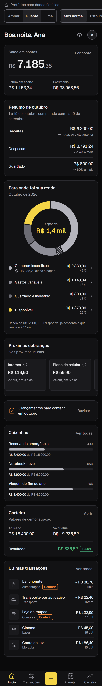
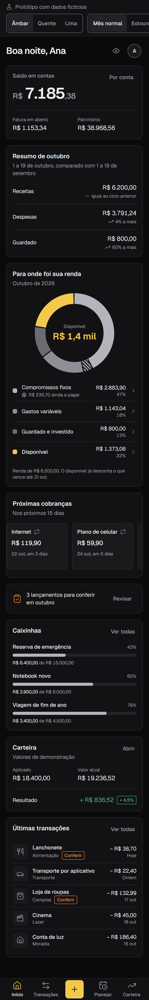
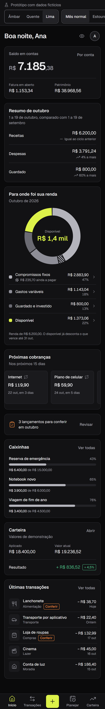

# Fase 1 — Relatório: correções críticas e design system

> Branch `fase-1-correcoes-e-design-system` · Plano: [`fase-1-plano.md`](fase-1-plano.md) (aprovado em 20/10/2026) · Status: **aguardando sua aprovação**

## O que foi feito

### Correções críticas no protótipo antigo (`legacy/`)
- API presa em `127.0.0.1`, CORS restrito à UI e rejeição de `Host` inesperado, contra *DNS rebinding* (C-06).
- Erro explícito com porta ocupada (A-12); recusa em iniciar com arquivo ilegível, em vez de começar vazio e sobrescrever (C-05).
- Backup antes de cada gravação e escrita atômica (C-05).
- `npm audit fix`: de 1 crítica, 1 alta e 2 moderadas para 0 vulnerabilidades (A-11).
- Dados locais, backups e `.env*` no `.gitignore` (A-08).

Os bugs de cálculo do protótipo antigo (C-01 a C-04) **não** foram corrigidos, como previsto no plano: os dados são fictícios e o app será substituído.

### App novo (`web/`)
- **Fundação:** React 19, Vite 8, TypeScript strict com `noUncheckedIndexedAccess`, Tailwind 4, ESLint `strict` (proíbe `toFixed` e `toISOString`), Prettier, Vitest, Testing Library e Playwright com axe.
- **Tokens** em `src/styles/tokens.css`, o único arquivo com cores (o lint falha se aparecer cor em outro lugar). A paleta padrão do Tailwind foi desligada.
- **Utilitários centrais:** dinheiro em centavos inteiros (formatação pt-BR, "R$ 4,2 mil", leitura do que a pessoa digita) e datas no fuso do usuário. Os dois corrigem a classe de erros C-01 e C-02.
- **16 componentes base** com estados: Button, Input, MoneyInput, Card, SegmentedControl, Badge, Tooltip, Dialog, BottomSheet, Toast, ProgressBar, Amount, EmptyState, ErrorState, Skeleton/LoadingRegion, List e o aviso de sem conexão.
- **Navegação:** barra inferior no mobile (Início, Transações, +, Planejar, Carteira), lateral no desktop, avatar levando a Configurações, link "Pular para o conteúdo". Destinos futuros mostram um estado vazio honesto.
- **Início com dados fictícios**, na ordem da seção 7.2 do briefing:
  - saudação, botão do modo privacidade e avatar;
  - saldo em contas, fatura em aberto e patrimônio, com detalhamento por conta;
  - resumo do ciclo comparando o mesmo intervalo do mês anterior;
  - rosca "Para onde foi sua renda" com quatro fatias fixas, compromissos a pagar hachurados, total "Disponível" em amarelo e cada fatia abrindo as transações que a compõem;
  - estouro (barra com o excedente) e ausência de receita (estado vazio);
  - próximas cobranças, pendências de revisão, caixinhas, carteira e últimas transações;
  - estados de carregando, erro e sem conexão.
- **Domínio do protótipo** como funções puras e testadas (`src/features/finance/derive.ts`), no formato do modelo de dados do diagnóstico, para a API substituir os dados fictícios na Fase 3 sem remodelagem.
- **`/design-system`:** cores, tabela de contraste recalculada ao vivo para a cor escolhida, tipografia, raios, e todos os componentes em todos os estados.
- **CI** (`.github/workflows/ci.yml`): lint, formatação, typecheck, testes, `npm audit`, build, E2E e varredura de segredos (gitleaks); auditoria e build do protótipo antigo.
- **Vercel:** `web/vercel.json` com reescrita de SPA e cabeçalhos de segurança.
- **WhatsApp:** passo a passo para abrir a conta, com fontes oficiais, em [`docs/whatsapp-preparacao.md`](../whatsapp-preparacao.md).

## Decisões e trade-offs

| Decisão | Registro | Trade-off principal |
|---|---|---|
| Radix primitives com componentes próprios | [ADR 0005](../adr/0005-componentes-radix-primitives.md) | Acessibilidade pronta, ao custo de uma dependência; BottomSheet sem gesto de arrastar. |
| Geist auto-hospedada | [ADR 0006](../adr/0006-fonte-geist.md) | Sem Google Fonts; cerca de 29 KB a mais no primeiro carregamento. |
| React Router | [ADR 0007](../adr/0007-roteamento-react-router.md) | Maduro, mas pesado; revisão marcada para a Fase 3. |
| `/design-system` em vez de Storybook | [ADR 0008](../adr/0008-design-system-como-rota.md) | Nenhuma dependência nova; sem isolamento por componente. |
| Paleta: valores finais | `tokens.css` | Ajustes sobre o ponto de partida do briefing, explicados abaixo. |
| Rosca em SVG próprio, sem Recharts | — | Hachura e cores por token sem lutar com a biblioteca. Recharts entra quando houver gráficos de barras e linhas (Fases 5 e 7). |

### Paleta: o que mudou em relação ao briefing

| Token | Briefing | Final | Motivo |
|---|---|---|---|
| Texto terciário | `#71717A` | `#8E8E97` | Reprovava AA em todas as superfícies (3,2 a 4,1:1). Agora passa nas quatro. |
| Negativo | `#E5534B` | `#EB6B63` | 4,23:1 na superfície mais clara; agora ≥ 5:1. |
| Borda | `#27272A` | `#2A2A2F` e borda forte `#6E6E77` | A borda sutil continua para cards; campos usam a forte, que passa 3:1 (WCAG 1.4.11). |

As três opções de amarelo passam AA como texto sobre todas as superfícies e com texto escuro por cima. Tudo isso é verificado por teste a cada build.

## Para você decidir

1. **Cor de destaque.** Compare os prints abaixo ou alterne na barra do protótipo. Minha recomendação é **Quente** (`#F5D547`): é o amarelo mais neutro dos três. O Âmbar puxa para o dourado e fica mais "banco tradicional". O Lima fica perto do verde-ácido, um dos clichês visuais que o briefing quer evitar. Depois da escolha, as outras duas saem do código.
2. **Arquitetura de informação** (diagnóstico §5.2): Início · Transações · [+] · Planejar · Carteira, com Configurações pelo avatar e o chat entrando pelo + e pelo WhatsApp. Aprova ou quer mudar algum destino?
3. **Gradiente tonal no cartão de saldo**, que o briefing deixa como exceção possível: não usei. O cartão já se destaca pela tipografia; recomendo manter sem.

## Como testar

```bash
cd web
npm install
npx playwright install chromium   # primeira vez
npm run dev                        # http://localhost:5173
```

1. Abra `/` em 390px (DevTools, modo dispositivo) e em 1280px.
2. Na barra do protótipo, alterne Âmbar, Quente e Lima e os cenários Estouro, Sem receita, Carregando, Erro e Sem conexão.
3. Toque no olho ao lado da saudação: todos os valores viram "R$ ••••"; recarregue e veja que a escolha foi lembrada.
4. Toque em cada linha da legenda da rosca: abre o detalhamento; Esc fecha.
5. Toque em "Por conta" no saldo e no botão +.
6. Navegue só com o teclado (Tab, Enter, Esc, setas no seletor).
7. Abra `/design-system` e confira a tabela de contraste para cada cor.
8. Rode `npm run lint && npm run typecheck && npm test && npm run test:e2e`.

## Prints

Gerados por `npm run prints`, com o relógio fixo em 19/10/2026 às 22:30 (horário de Brasília).

| Quente | Âmbar | Lima |
|---|---|---|
|  |  |  |

Desktop 1280px: [Quente](fase-1/inicio-1280-quente.png) · [Âmbar](fase-1/inicio-1280-ambar.png) · [Lima](fase-1/inicio-1280-lima.png)
Estados: [Estouro](fase-1/inicio-390-estouro.png) · [Sem receita](fase-1/inicio-390-sem-receita.png)
Design system: [1280px](fase-1/design-system-1280.png) · [390px](fase-1/design-system-390.png)

## Critérios de aceite

- [ ] CI verde no PR. *A verificar quando o PR for aberto: o workflow ainda não rodou no GitHub. Localmente, todas as etapas passam.*
- [x] `npm audit` sem vulnerabilidade alta ou crítica em `legacy/` e `web/` (0 nos dois).
- [x] Nenhuma cor literal fora de `tokens.css` (verificado no `npm run lint`).
- [x] Todos os pares texto/fundo passam AA, nas três opções de amarelo (testes de unidade e E2E).
- [x] `/design-system` mostra cada componente em todos os seus estados.
- [x] Início navegável em 390px e 1280px nas três cores, com modo privacidade, estouro e sem receita.
- [x] Zero emojis; alvos ≥ 44px; foco visível; `prefers-reduced-motion` respeitado; axe sem violações sérias ou críticas.
- [x] `legacy/` sobe com `npm run dev` dentro da pasta.
- [x] ADRs 0005–0008 e relatório com prints.

Números locais: 113 testes de unidade e componente, 22 E2E (11 cenários × 2 larguras), todos passando.

## Pendências

- **Abrir o PR e confirmar o CI verde.** O GitHub CLI não está instalado nesta máquina; o PR sai pelo link da branch.
- **Conectar a Vercel ao repositório** (exige seu login): projeto com raiz em `web/`, para cada PR ganhar um link de preview.
- **Bundle:** o JS inicial tem 150 KB gzip (react-dom e react-router são a maior parte). O orçamento entra na Fase 3, junto com a revisão do roteador.
- **Revisão de segurança automática:** a do commit `4320c32` não rodou (a API estava ocupada, HTTP 429). Os commits seguintes passam pela revisão normalmente.
- Componentes adiados para a Fase 3, conforme o plano: Select, DatePicker, Tabs, Table.

## Riscos

- **Protótipo pode parecer pronto.** A barra "Protótipo com dados fictícios" aparece em todas as telas e o botão + avisa que nada é salvo.
- **Dados fictícios relativos a "hoje".** Nos primeiros dias do mês, o Início fica com poucas transações; isso é esperado e mostra os estados reais de início de ciclo.
- **Prazos da Meta** para a Fase 6: a verificação do negócio pode levar semanas. Comece pelos passos em `docs/whatsapp-preparacao.md`.

## Proposta para a Fase 2 — Núcleo financeiro

1. **ADRs de infraestrutura**, com preços e limites consultados na documentação vigente: host da API (candidatos Fly.io, Render, Railway), Postgres gerenciado (Supabase ou Neon, só como banco) e autenticação (Spring Security com sessão em cookie httpOnly, ou Supabase Auth com JWT validado no back).
2. **`api/` em Java 21 + Spring Boot:** Flyway, esquema a partir do diagnóstico §5.1 com `workspace_id` em tudo (ADR 0002), dinheiro em `BIGINT`, datas `DATE` no fuso do usuário.
3. **Domínio com testes primeiro:** saldo derivado, transferência, cartão, fatura e parcelas, ciclo configurável, recorrências, idempotência e exclusão lógica. Testcontainers para o banco.
4. **Testes de isolamento** entre usuários e workspaces em todos os endpoints.
5. **Contrato OpenAPI** com cliente TypeScript gerado para o `web/`.
6. **Migração dos dados antigos:** como você confirmou que são todos de teste, proponho **não migrar** e começar do zero, o que elimina o script e o relatório de divergências previstos. Confirma?

Tamanho estimado: **G**.
